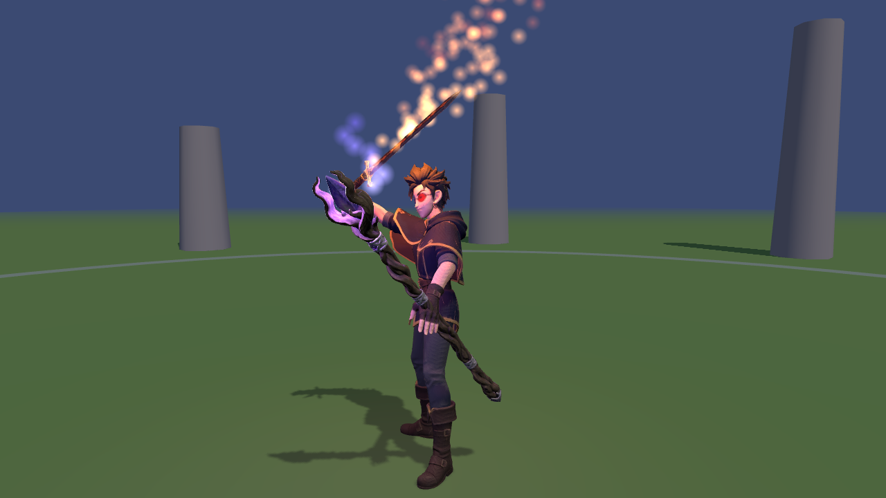
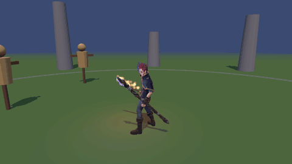
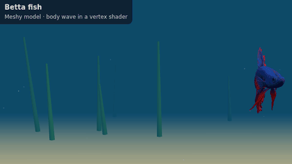
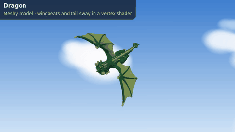
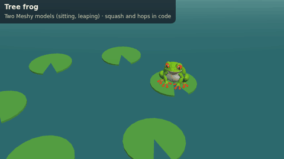
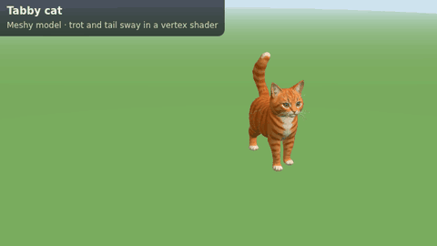
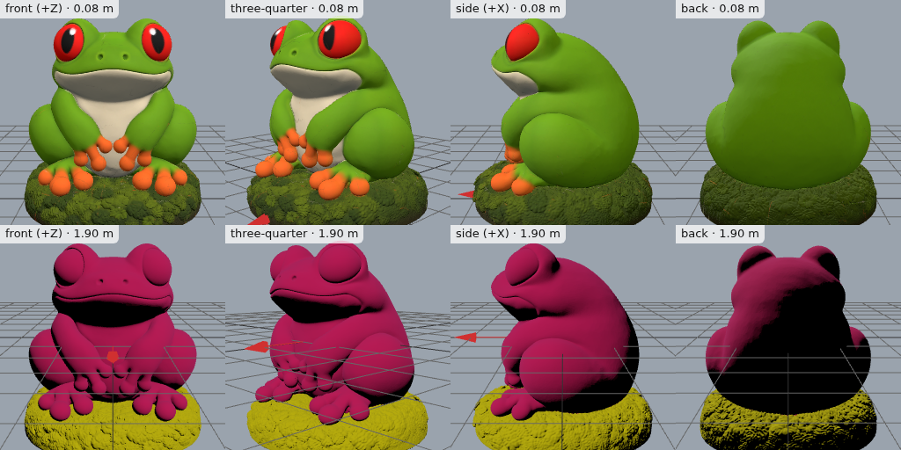
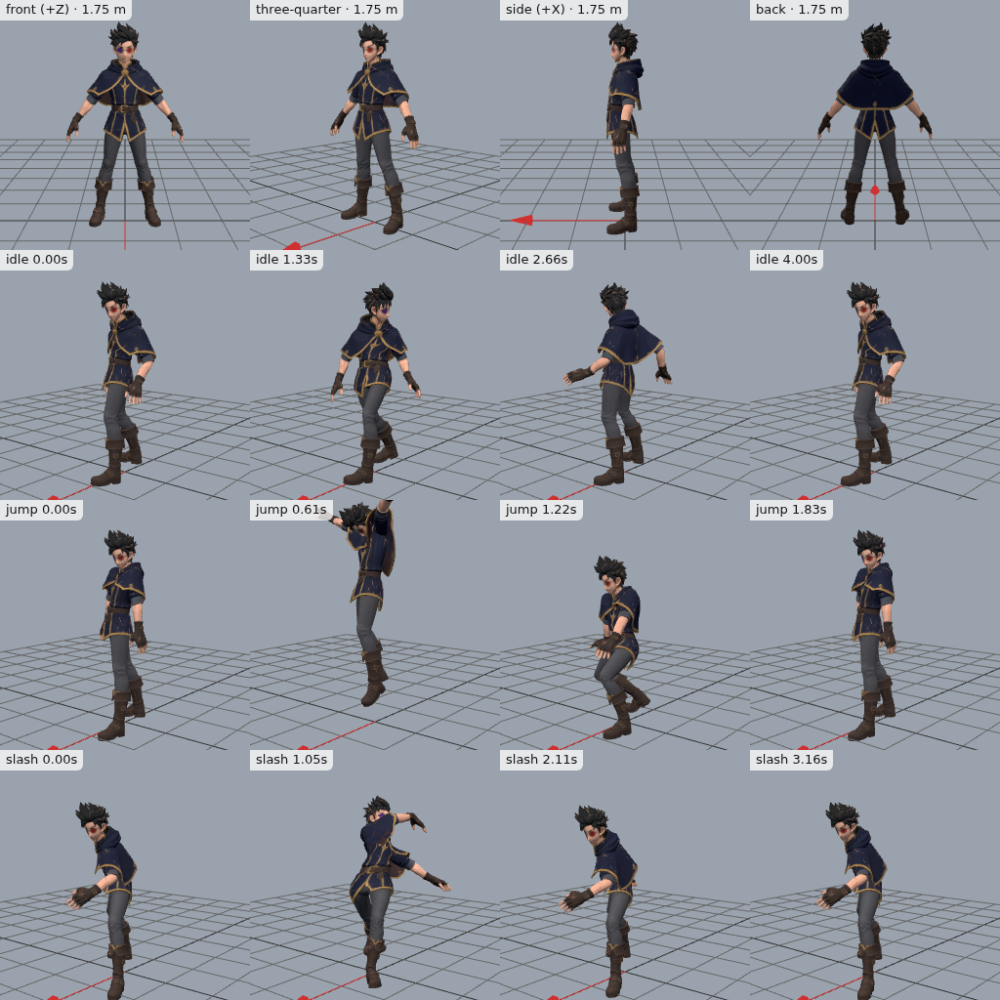

# meshgen

Generate 3D game assets (textured models, rigged characters and their
animations) from a single [Claude Code](https://github.com/anthropics/claude-code)
skill, backed by the [Meshy](https://www.meshy.ai) API. Describe a model or
hand it a picture, and you get one GLB per asset, with every animation clip
inside, sized in meters and ready for three.js, Godot and most other
engines. It also makes STL and 3MF files for 3D printing. Zero npm deps:
usable as a `/meshgen` slash command inside an agent, or as a standalone Node
CLI from your terminal.

It's a sibling of [imagegen2](https://github.com/zeveck/imagegen2),
[anim8gen](https://github.com/zeveck/anim8gen),
[audiogen](https://github.com/zeveck/audiogen) and
[nanogen](https://github.com/zeveck/nanogen).

---

## See it

<a href="https://zeveck.github.io/meshgen/mage/">
  
</a>

**[Play the Mage Playground](https://zeveck.github.io/meshgen/mage/)** in
your browser (keyboard and mouse), or see
[all the demos](https://zeveck.github.io/meshgen/). The mage, staff and
sword came from three imagegen2 concept pictures and these meshgen commands:

```
/meshgen character mage --image concepts/mage.png --height 1.75 --actions idle,walk,run,jump,slash,cast,spell=129,hit,die,dodge,wave
/meshgen model staff --image concepts/staff.png --height 1.6
/meshgen model sword --image concepts/sword.png --height 1.0
```

<a href="https://zeveck.github.io/meshgen/mage/"></a>

The clips (slash, spell, walk, run and seven more) are Meshy's, on Meshy's
rig. The flames, fireballs and nova are three.js effects in the game's code.

### Creatures, animated in code

Meshy rigs humanoids. Everything else is a plain model you can bring to life
in a few lines of shader code, like these four from the
[Creature Showcase](https://zeveck.github.io/meshgen/creatures/)
(30 credits each, no skeleton):

<table>
  <tr>
    <td><a href="https://zeveck.github.io/meshgen/creatures/"></a></td>
    <td><a href="https://zeveck.github.io/meshgen/creatures/"></a></td>
  </tr>
  <tr>
    <td><a href="https://zeveck.github.io/meshgen/creatures/"></a></td>
    <td><a href="https://zeveck.github.io/meshgen/creatures/"></a></td>
  </tr>
</table>

### Ready for 3D printing

Ask for a print instead of a game asset and meshgen switches gears: full
detail, sizes in millimeters, STL and 3MF files, and Meshy's print check,
repair, multi-color and split steps.
[An 80 mm frog figurine](examples/print) took 60 credits:



### A preview sheet with every asset

meshgen checks each asset with a screenshot sheet: four views with the
height and a red arrow pointing to the front, then frames from every clip.
Here is the top of the mage's
([full sheet](examples/mage/assets/meshgen/mage/preview/sheet.png)):



---

## Install

### Claude Code

Install meshgen as a Claude Code plugin (Claude Code 2.1.275 or later):

```text
/plugin install meshgen --marketplace zeveck/meshgen
```

Or in two steps, which also works on older versions:

```text
/plugin marketplace add zeveck/meshgen
/plugin install meshgen@meshgen
```

The skill is then available as `/meshgen` (or `/meshgen:meshgen`). Update to
a new release with:

```bash
claude plugin marketplace update meshgen
claude plugin update meshgen@meshgen
```

then run `/reload-plugins` in any open session. `claude plugin list` shows the
installed version, and `node <skill>/meshgen.cjs --version` prints it.

Without the plugin system, copy the `skills/meshgen/` folder (it includes the
preview viewer) into `.claude/skills/meshgen/` in a project or your user
skills directory. Copies don't update; re-copy to upgrade.

```bash
git clone --depth 1 https://github.com/zeveck/meshgen /tmp/meshgen
mkdir -p .claude/skills && cp -r /tmp/meshgen/skills/meshgen .claude/skills/
node .claude/skills/meshgen/meshgen.cjs --version
```

---

## Configure

```bash
# Option A — export in your shell
export MESHY_API_KEY='msy_...'

# Option B — .env at project root (auto-loaded)
echo 'MESHY_API_KEY=msy_...' > .env
```

Get a key at meshy.ai under Settings > API. Meshy's API needs a paid plan.
Node **≥ 20.12** is required (for the built-in `process.loadEnvFile`).

Preview screenshots use [playwright-cli](https://www.npmjs.com/package/@playwright/cli)
with Chromium (`npm install -g @playwright/cli`, then
`npx playwright install chromium`). Everything else works without it.

---

## Use

### From Claude Code

Ask in plain words. The agent picks the command, writes the prompt, and for
characters suggests an imagegen2 concept picture first, because pictures keep
details that text loses.

```
/meshgen a rigged knight that can walk, run, block and swing a sword
/meshgen a low-poly wooden treasure chest, about 0.6 m tall
/meshgen add a dance and a wave to the knight
/meshgen a 3D-printable dragon figurine, 80 mm tall
```

It tells you the cost in credits before spending, unless you've already given
it a budget.

### From the shell

`meshgen.cjs` is a self-contained Node CLI:

```bash
node skills/meshgen/meshgen.cjs character hero --image hero.png --height 1.8 \
  --actions idle,walk,run,jump,slash,cast,hit,die
node skills/meshgen/meshgen.cjs model chest --prompt "wooden treasure chest with iron bands" --height 0.6
node skills/meshgen/meshgen.cjs animate hero dance wave
node skills/meshgen/meshgen.cjs preview hero
```

That's the path in a clone of this repository. With the plugin, the CLI is in
the plugin cache (`~/.claude/plugins/cache/meshgen/meshgen/<version>/meshgen/`).

Each asset gets a folder like `assets/meshgen/hero/` holding `hero.glb` (the
file your game loads), `preview/sheet.png`, `meshgen.json` and Meshy's
original downloads in `source/`. Every command prints one JSON line.

---

## What it does

| Command | Meshy endpoint | Credits |
|---|---|---|
| `model <name>` | `POST /openapi/v2/text-to-3d` or `/v1/image-to-3d` | 30 (15 with `--draft`) |
| `character <name>` | model, then `POST /v1/rigging`, then `POST /v1/animations` | about 50 with 7 clips |
| `rig <name>` | `POST /v1/rigging`: a skeleton, plus free walk and run clips | 5 |
| `animate <name> <actions...>` | `POST /v1/animations`, up to 10 clips a call | 3 each |
| `remesh <name>` | `POST /v1/remesh` | 5 |
| `model <name> --print` | as `model`, at full detail with STL and 3MF | 30 |
| `printcheck <name>` | `POST /v1/print/analyze`: holes and thin walls | free |
| `repair <name>` | `POST /v1/print/repair`: fixes holes, thickens thin walls | 10 |
| `multicolor <name>` | `POST /v1/print/multi-color`: a multi-color 3MF for your printer | 10 |
| `split <name>` | `POST /v1/print/split`: parts that print separately | 10 |
| `balance` | `GET /v1/balance` | free |
| `actions [word]` | `GET /v1/animations/library`: 600+ animations | free |
| `rebuild <name>` | none: remakes the GLB from saved files with new options | free |
| `inspect <name or file.glb>` | none: height, triangles, bones, clips, textures | free |
| `preview <name or file.glb>` | none: the screenshot sheet | free |
| `view <name or file.glb>` | none: an interactive viewer in your browser | free |

Meshy's credits cost about $0.02 each on the Pro plan.

Plus:

- **One file per asset.** The rigged character and every clip are merged
  into one GLB. Clips are named after the words you used (`idle`, `slash`,
  `cast`) and play in place, so your game moves the character.
- **Game-sized.** Models come out at 30,000 triangles for characters and
  10,000 for props, with textures shrunk to 1024 px. A character is about
  6 MB. Meshy's raw output is often 200,000-900,000 triangles.
- **Plain action names.** idle, walk, run, jump, attack, slash, cast, hit,
  die, block, dodge, wave, dance and about twenty more, or any library
  action by id (`spell=129`).
- **Never pays twice.** Jobs are saved the moment they start. If Meshy is
  still busy when the command stops waiting, run it again and it picks the
  job back up.
- **No overwrites.** A new model with a taken name becomes `-v2`, `-v3`.
- **Game or print, not both at once.** Game guidance is the default; when
  you ask for a print, the agent reads a separate
  [`printing.md`](skills/meshgen/printing.md) about millimeters, solid
  shapes, overhangs and Meshy's repair, multi-color and split steps, and
  skips the rigging and engine advice.
- **Zero dependencies.** Node's built-in `fetch`, `zlib` and
  `process.loadEnvFile`; three.js 0.186.1 (MIT) is vendored for previews.

See [`SKILL.md`](skills/meshgen/SKILL.md) for how the agent uses it, and
[`reference.md`](skills/meshgen/reference.md) for loading the GLBs in
three.js and Godot, attaching weapons to hands, and when to use Meshy's clips
versus animating in code.

### Options

| Option | Meaning |
|---|---|
| `--prompt <text>` | What to make |
| `--image <path or url>` | A reference picture; repeat for side and back views (front first) |
| `--texture-prompt <text>` | Extra guidance for the textures |
| `--draft` | Cheaper and rougher |
| `--height <meters>` | How tall the character or model is |
| `--polycount <n>` | Triangles; defaults are 30,000 for characters and 10,000 for models |
| `--topology <t>` | `triangle` or `quad` |
| `--pose <p>` | `a-pose`, `t-pose` or `none` |
| `--pbr` | Metallic, roughness and normal maps |
| `--texture <res>` | The texture size Meshy paints: `2k`, `4k` or `8k` |
| `--max-texture <px>` | Shrink PNG textures in the GLB to fit (default 1024; `0` keeps them) |
| `--formats <list>` | Also save `fbx`, `obj`, `usdz`, `stl` or `3mf` |
| `--actions <list>` | Animations for `character` |
| `--quadruped` | A four-legged rig with a walk clip (experimental) |
| `--root-motion` | Keep the clips' own forward movement (normally they play in place) |
| `--no-root-motion` | Back to in-place clips, with `rebuild` or `animate` |
| `--dir <path>` | Where asset folders go (default `assets/meshgen`) |
| `--max-credits <n>` | Refuse to start if it would cost more |
| `--wait <seconds>` | How long to wait for Meshy before handing back (default 540) |
| `--print` | Make a `model` for 3D printing |
| `--height-mm <n>` | Planned print height in millimeters |
| `--printer <type>` | `fdm`, `sla` or `full_color`, for `printcheck` and `repair` |
| `--colors <n>` | Up to 16 colors, for `multicolor` (default 4) |
| `--style <s>` | `realistic` or `cartoon`, for `multicolor` |
| `--printer-brand <b>` | Slicer preset for `multicolor`: `bambu`, `prusa`, `creality` and more |
| `--parts <text>` | Which parts `split` cuts along |
| `--plate` | `split` lays the parts flat on the build plate |
| `--connectors` | `split` adds pegs so the parts fit together |
| `--clips <list>` | Which clips `preview` shows |
| `--port <n>` | Port for `view` (default 8737) |
| `--category <name>` | Filter for `actions` |
| `--dry-run` | Show what would be sent and what it costs, without calling Meshy |
| `--no-history` | Don't add to `.meshgen-history.jsonl` |

---

## Licensing & terms

- **Your generated models**: on a paid Meshy plan you own the output and
  can use it commercially (Meshy's plan terms; the API needs a paid plan).
- **Meshy keeps API results for 3 days.** meshgen downloads everything at
  once, so the files in `source/` are the lasting copies.
- **three.js** is vendored under its MIT license
  ([`skills/meshgen/viewer/vendor/LICENSE`](skills/meshgen/viewer/vendor/LICENSE)).

---

## Repository Layout

The distributable skill lives in `skills/meshgen/` (`SKILL.md`,
`meshgen.cjs`, `reference.md`, and `viewer/` with the preview page and
three.js). The plugin is rooted at `skills/`, so an install copies only the
skill: `skills/.claude-plugin/plugin.json` is the plugin manifest and
`.claude-plugin/marketplace.json` the marketplace. Test the plugin locally
with `claude --plugin-dir skills`. Releases are listed in
[`CHANGELOG.md`](CHANGELOG.md).

## Development

```bash
npm test      # node --test tests/*.test.mjs
```

The tests run against a fake Meshy server on your machine, with tiny GLBs
built in the tests, so they spend no credits. CI runs them on every push.

---

## Credits

Shape and spirit borrowed from
[imagegen2](https://github.com/zeveck/imagegen2) and
[audiogen](https://github.com/zeveck/audiogen): a zero-dep, single-folder
skill with a Node CLI that prints JSON. meshgen's `.env` walker mirrors
imagegen2's. The Mage Playground's concept pictures came from imagegen2.

## License

MIT
