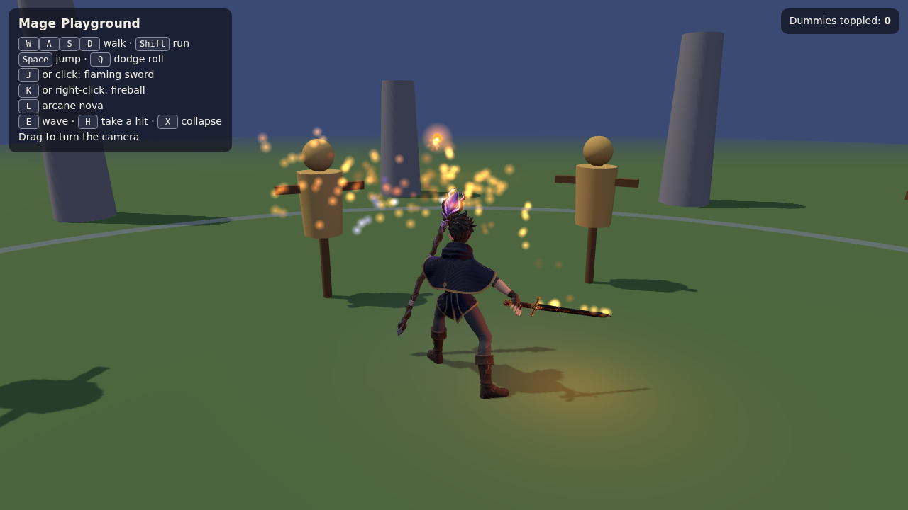

# meshgen

3D game assets from a sentence or a picture. meshgen is a Claude Code skill
and a zero-dependency Node CLI for [Meshy](https://www.meshy.ai): it makes
textured models, rigs humanoid characters, adds animations like idle, walk,
run, jump, slash, cast and die, and hands you one GLB per asset that drops
straight into three.js, Godot or most other engines. It also makes STL and
3MF files for 3D printing.

It's a sibling of [imagegen2](https://github.com/zeveck/imagegen2),
[anim8gen](https://github.com/zeveck/anim8gen),
[audiogen](https://github.com/zeveck/audiogen) and
[nanogen](https://github.com/zeveck/nanogen).



The mage above came from one imagegen2 picture and one meshgen command, with
the staff and sword made the same way. Play with it in
[examples/mage](examples/mage).

## Install

In Claude Code:

```
/plugin marketplace add zeveck/meshgen
/plugin install meshgen@meshgen
```

Then ask for what you want: "make a rigged knight that can walk, run, block
and swing a sword", or "a low-poly treasure chest for my game".

## Requirements

- Node.js 20.12 or newer.
- A Meshy API key on a paid Meshy plan, in your project's `.env`:
  `MESHY_API_KEY=msy_...` (meshy.ai > Settings > API).
- For preview screenshots: [playwright-cli](https://www.npmjs.com/package/@playwright/cli)
  with Chromium (`npm install -g @playwright/cli`, then
  `npx playwright install chromium`). Everything else works without it.

## What it costs

Meshy charges credits; on the Pro plan they're about $0.02 each.

| Asset | Credits |
|---|---|
| A model from text or a picture | 30 (15 with `--draft`) |
| A character with idle, walk, run, jump, attack, hit and die | about 50 |
| Each extra animation | 3 (walk and run come free with every rig) |
| Remeshing | 5 |
| Checking credits, searching animations, inspecting, previews, `--dry-run` | free |

## Using the CLI

```bash
node skills/meshgen/meshgen.cjs character hero --image hero.png --height 1.8 \
  --actions idle,walk,run,jump,slash,cast,hit,die
node skills/meshgen/meshgen.cjs model chest --prompt "wooden treasure chest with iron bands" --height 0.6
node skills/meshgen/meshgen.cjs animate hero dance wave
node skills/meshgen/meshgen.cjs preview hero
```

Each asset gets a folder like `assets/meshgen/hero/` holding `hero.glb` (the
file your game loads), `preview/sheet.png`, `meshgen.json` and Meshy's
original downloads in `source/`. Every command prints one JSON line.

| Command | What it does |
|---|---|
| `balance` | Credits left and the reset date |
| `actions [word]` | Plain action names, or search Meshy's 600+ animations |
| `model <name>` | A textured model from `--prompt` or `--image` |
| `character <name>` | Model in A-pose, rig, animations, preview |
| `remesh <name>` | A new triangle count |
| `rig <name>` | A skeleton, plus free walk and run clips |
| `animate <name> <actions...>` | More clips, by plain name or `name=<library id>` |
| `rebuild <name>` | Remake the GLB from saved files with new options |
| `inspect <name or file.glb>` | Height, triangles, bones, clips and textures |
| `preview <name or file.glb>` | A screenshot sheet: four views and frames of every clip |
| `view <name or file.glb>` | An interactive viewer in your browser |
| `printcheck <name>` | Meshy's check for holes and thin walls before printing |

| Option | Meaning |
|---|---|
| `--prompt <text>` | What to make |
| `--image <path or url>` | A reference picture; repeat for side and back views (front first) |
| `--texture-prompt <text>` | Extra guidance for the textures |
| `--draft` | Cheaper and rougher |
| `--height <meters>` | How tall the character or model is |
| `--polycount <n>` | Triangles; defaults are 30,000 for characters and 10,000 for models |
| `--topology <t>` | `triangle` or `quad` |
| `--pose <p>` | `a-pose`, `t-pose` or `none` |
| `--pbr` | Metallic, roughness and normal maps |
| `--texture <res>` | The texture size Meshy paints: `2k`, `4k` or `8k` |
| `--max-texture <px>` | Shrink PNG textures in the GLB to fit (default 1024; `0` keeps them) |
| `--formats <list>` | Also save `fbx`, `obj`, `usdz`, `stl` or `3mf` |
| `--actions <list>` | Animations for `character` |
| `--root-motion` | Keep the clips' own forward movement (normally they play in place) |
| `--no-root-motion` | Back to in-place clips, with `rebuild` or `animate` |
| `--dir <path>` | Where asset folders go (default `assets/meshgen`) |
| `--max-credits <n>` | Refuse to start if it would cost more |
| `--wait <seconds>` | How long to wait for Meshy before handing back (default 540) |
| `--height-mm <n>` | Print height for `printcheck` |
| `--printer <type>` | `fdm`, `sla` or `full_color` for `printcheck` |
| `--clips <list>` | Which clips `preview` shows |
| `--port <n>` | Port for `view` (default 8737) |
| `--category <name>` | Filter for `actions` |
| `--dry-run` | Show what would be sent and what it costs, without calling Meshy |
| `--no-history` | Don't add to `.meshgen-history.jsonl` |

If Meshy takes longer than `--wait`, run the same command again: meshgen
picks the job back up and never pays twice.

## Tests

```bash
npm test
```

The tests run against a fake Meshy on your machine and spend no credits.

## License

MIT
