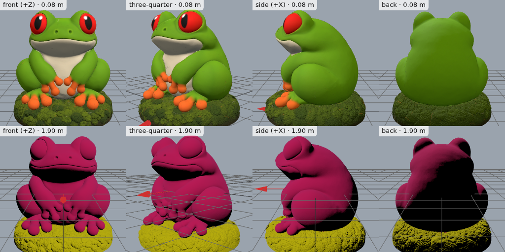

# Frog figurine for 3D printing

An 80 mm tree frog figurine on a mossy base, made for printing rather than a
game. The concept picture in `concepts/` came from imagegen2, asked for a
print-friendly shape: compact, chunky toes, limbs touching the body, a flat
round base.

```bash
meshgen model frog-figurine --print --image concepts/frog-figurine.png --height-mm 80   # 30 credits
meshgen printcheck frog-figurine --height-mm 80 --printer fdm                            # free
meshgen repair frog-figurine --height-mm 80 --printer fdm                                # 10
meshgen multicolor frog-figurine --colors 6 --style cartoon                              # 10
meshgen split frog-figurine --parts "frog, base" --connectors                            # 10
```

What came back (60 credits in all):

- **The model:** 1.4 million triangles at full detail, with STL and 3MF files.
- **printcheck:** watertight, no holes, no non-manifold edges, and walls fine
  for FDM at 80 mm. Its only warning was about 330,000 zero-area triangles,
  which slicers cope with.
- **repair:** an uncolored GLB, plus an 80 mm STL that meshgen wrote from it
  for single-color printing.
- **multicolor:** a 3MF with six filament colors for Bambu Studio. Meshy chose
  the greens, orange toes and cream belly, and dropped the small red eyes.
  Ask for more colors when a small feature matters.
- **split:** the frog and its base as separate parts with connector pegs, in
  GLB, STL and 3MF.

The print files are 20-70 MB each, so they aren't in the repository; the
commands above make them again. The preview sheet is in
`assets/meshgen/frog-figurine/preview/`.


